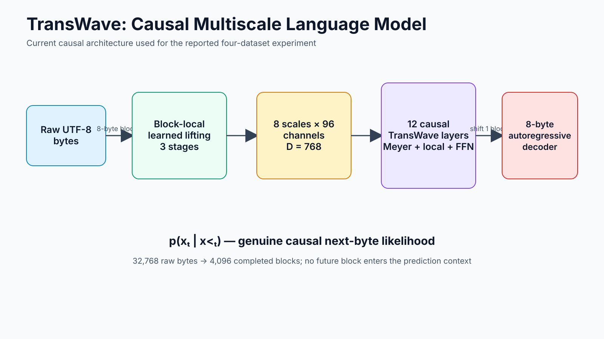
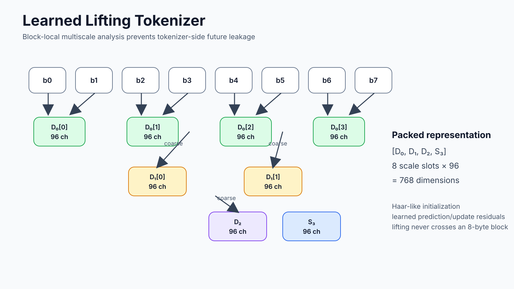
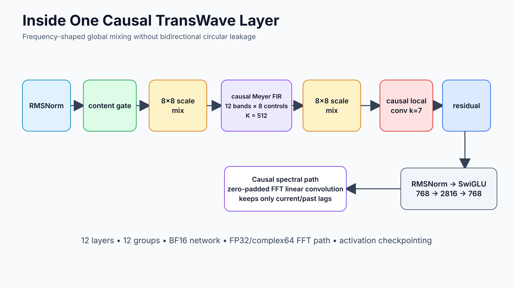
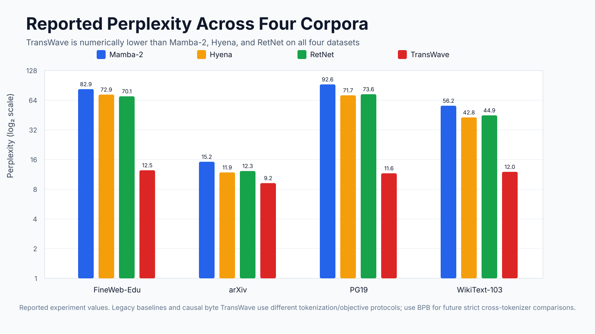
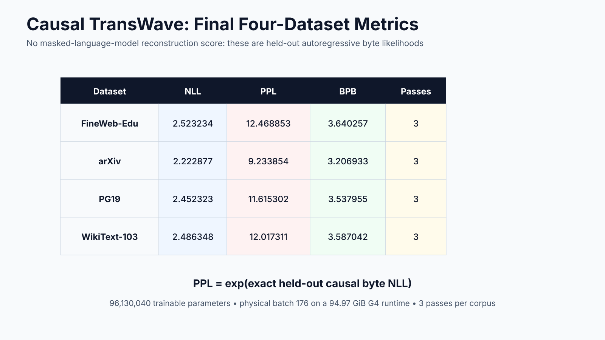
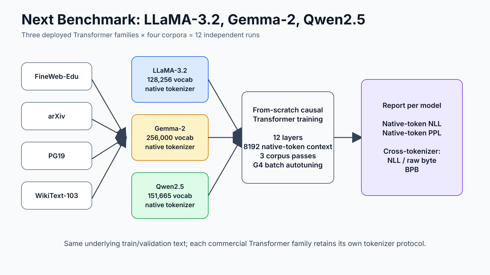

# TransWave

TransWave is a causal multiscale language model that replaces attention with a learned lifting front end, causal Meyer-shaped global mixing, cross-scale mixing, local causal convolution, and an autoregressive byte decoder.

The current implementation operates directly on UTF-8 bytes. Every reported TransWave perplexity below is computed from genuine held-out causal next-byte likelihood:

`PPL = exp(NLL)`

## Architecture

The current causal model uses 32,768 raw bytes per training sequence, compressed into 4,096 completed eight-byte blocks. A block-local learned lifting transform creates eight multiscale slots of 96 channels each, giving a 768-dimensional representation. Twelve causal TransWave layers then perform scale mixing, causal Meyer FIR filtering, causal local convolution and SwiGLU processing. The representation is shifted by one completed block before an intra-block autoregressive byte decoder predicts the next eight bytes.

## Learned multiscale tokenizer

The learned tokenizer is part of the model and is optimized end-to-end. Lifting is restricted to each eight-byte block, preventing a convolutional boundary from leaking information from the next block.

## Causal TransWave layer

The spectral path is implemented as one-sided linear convolution. Zero-padded FFTs are used for computational efficiency, but only current and past lags contribute to each output.

## Four-corpus experiment

The current experiment uses FineWeb-Edu, arXiv, PG19 and WikiText-103. Each corpus is trained independently for three passes.

### Reported validation NLL

| Model | FineWeb-Edu | arXiv | PG19 | WikiText-103 |
|---|---:|---:|---:|---:|
| Mamba-2 | 4.417161 | 2.721178 | 4.528377 | 4.029364 |
| Hyena | 4.289595 | 2.472997 | 4.272470 | 3.756758 |
| RetNet | 4.249693 | 2.505527 | 4.298588 | 3.804997 |
| **TransWave** | **2.523234** | **2.222877** | **2.452323** | **2.486348** |

### Reported perplexity

| Model | FineWeb-Edu | arXiv | PG19 | WikiText-103 |
|---|---:|---:|---:|---:|
| Mamba-2 | 82.860734 | 15.198222 | 92.608091 | 56.225123 |
| Hyena | 72.936943 | 11.857936 | 71.698544 | 42.809413 |
| RetNet | 70.083923 | 12.250016 | 73.595795 | 44.925102 |
| **TransWave** | **12.468853** | **9.233854** | **11.615302** | **12.017311** |

The reported TransWave values are genuine byte-level autoregressive metrics. The older Mamba-2, Hyena and RetNet runs came from the earlier tokenized baseline experiment, so their NLL/PPL units are not a strict tokenizer-independent comparison. The repository therefore retains the numbers as reported and uses bits per raw byte for the next cross-tokenizer benchmark.

## Causal TransWave results

| Dataset | NLL | PPL | BPB | Passes |
|---|---:|---:|---:|---:|
| FineWeb-Edu | 2.523234 | 12.468853 | 3.640257 | 3 |
| arXiv | 2.222877 | 9.233854 | 3.206933 | 3 |
| PG19 | 2.452323 | 11.615302 | 3.537955 | 3 |
| WikiText-103 | 2.486348 | 12.017311 | 3.587042 | 3 |

Current causal model size: **96,130,040 trainable parameters**. The complete-step G4 probe selected physical batch **176**, peaking at roughly **89.99 GiB reserved VRAM** on a 94.97 GiB runtime.

## Transformer benchmark

The next benchmark is deliberately restricted to Transformer families used in modern deployed LLMs: LLaMA-3.2, Gemma-2 and Qwen2.5. Each family uses its own native tokenizer and is trained from scratch on all four corpora.

Native tokenization is already prepared. The resulting stream sizes are in `results/native_token_counts.csv`. Native-token NLL/PPL will be reported for each family, while NLL per raw byte and BPB provide the cross-tokenizer comparison.

## Repository contents

- `src/causal_transwave.py` — exact current causal TransWave experiment cell extracted from the notebook.
- `src/native_tokenization.py` — exact current native-tokenization cell for LLaMA-3.2, Gemma-2 and Qwen2.5.
- `notebooks/TransWave_G4_Experiment.ipynb` — latest complete working notebook supplied for this repository.
- `results/` — machine-readable result tables and native tokenizer stream counts.
- `assets/` — six README illustrations.
- `docs/` — static GitHub Pages site.
- `medium/` — Medium-ready article.

## GitHub Pages

The repository contains a static site under `docs/`. In GitHub, open **Settings → Pages**, choose **Deploy from a branch**, select the main branch, and select `/docs` as the site folder.

No Jekyll configuration or hidden files are required.

## Reproducibility

The notebook is designed for a high-memory NVIDIA G4/RTX PRO 6000 Blackwell runtime and uses BF16 network computation with FP32/complex64 FFT computation. Paths in the experiment code are Google Colab/Drive paths and can be changed for another environment.

The native Transformer benchmark uses public tokenizer/config repositories and initializes model weights from scratch.

## License

MIT.
